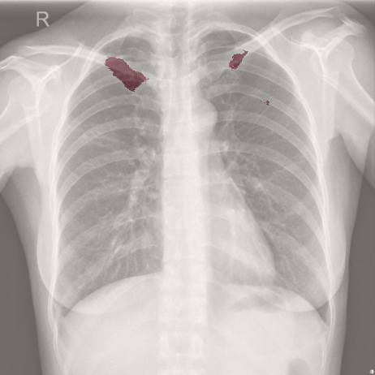
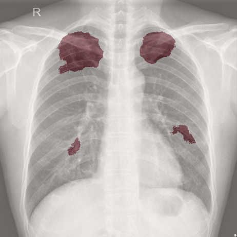
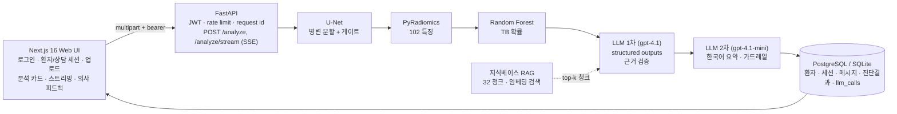

<h1 align="center">X-ray TB Radiomics + LLM Diagnostic Assistant</h1>

<p align="center">
흉부 X-ray에서 결핵 의심 병변을 <b>찾고(U-Net)</b>, 영역의 특징을 <b>수치화하고(Radiomics)</b>, <b>판정하고(Random Forest)</b>,<br/>
그 근거를 LLM이 <b>임상의용 리포트로 해석</b>하는 임상 의사결정 지원(CDS) 시스템
</p>

<p align="center">


</p>

<p align="center">
  
  &nbsp;
  
</p>
<p align="center"><sub>Shenzhen CXR 데이터셋에 대한 U-Net 병변 분할 결과 (붉은 영역 = 예측 마스크)</sub></p>

> **면책**: 연구·교육 목적의 프로토타입입니다. 의료기기가 아니며, 어떤 출력도 임상 판단을 대체하지 않습니다.

## 한눈에 보기

| | |
| --- | --- |
| **입력** | 정면 흉부 X-ray (PNG/JPEG) + 임상의의 메모, 그리고 후속 질문 |
| **출력** | 병변 오버레이 · 폐야 구역과 면적 · TB 확률과 위험도 · 상위 기여 특징 · 구조화 JSON 리포트(근거 인용 포함) · 한국어 임상의용 요약(스트리밍) |
| **실데이터 성능** | Shenzhen 662장 종단 ROC-AUC **0.897**, 민감도 81.9%, 특이도 85.6% — 합성 데이터 없이, 교차검증으로 ([상세](docs/evaluation.md)) |
| **지연** | 업로드 → 분할 → Radiomics → 분류 **0.3–0.5초** (CPU), 이후 LLM 2회 호출 (요약은 토큰 스트리밍) |
| **운영** | JWT 인증 · 환자 데이터 의사별 격리 · PostgreSQL + Alembic · Docker Compose · GitHub Actions CI · 요청 ID 로깅 · LLM 비용/지연 텔레메트리 |
| **스택** | TensorFlow 2.15 U-Net · PyRadiomics · scikit-learn · FastAPI · SQLAlchemy · Next.js 16 · OpenAI (structured outputs, embeddings) |

## 왜 이렇게 만들었나

딥러닝 분류기 하나로 "결핵 / 정상"을 찍지 않고 **찾기 → 수치화 → 판정 → 해석** 네 단계를 분리했습니다. 각 단계의 출력이 사람이 검토할 수 있는 형태(마스크, 특징 수치, feature importance, 근거 필드)로 남아서, 임상의가 "왜 이런 판단이 나왔는지"를 따라갈 수 있습니다.

| 단계 | 기술 | 출력 |
| --- | --- | --- |
| 1. 병변 분할 | U-Net (TensorFlow/Keras, 7.8M 파라미터) | 512×512 마스크, 확률맵 |
| 2. 게이트 + 통계 | 연결 성분 분석 | 면적 비율, 성분 수, 폐야 구역(right/left × upper/middle/lower) |
| 3. 특징 추출 | PyRadiomics | 102개 정량 특징 (shape2D, first-order, GLCM, GLRLM, GLSZM, GLDM, NGTDM) |
| 4. 분류 | Random Forest (scikit-learn, 5-fold CV ROC-AUC 0.891) | `tb_probability`, `risk_level`, 상위 기여 특징 |
| 5. 해석 | OpenAI LLM 2단계 + RAG | ① 구조화 리포트 (gpt-4.1, pydantic 스키마 강제, 지식베이스 청크 인용) → ② 한국어 임상의용 요약 (gpt-4.1-mini, 스트리밍) |

## 시스템 구성



학습·평가 스크립트와 API 서버가 **같은 파이프라인 코드**(`model/src/pipeline.py`)로 전처리·특징 추출을 하기 때문에 학습 분포와 운영 분포가 어긋나지 않습니다. 전처리는 학습 때 쓴 `tf.image.resize`를 NumPy로 재현했고, 원본 TF 전처리 대비 마스크 IoU 0.99 로 검증했습니다.

## 데모 흐름

1. 로그인 (운영자가 발급한 임상의 계정) → 환자 등록 → 상담 세션 선택 또는 "새 상담".
2. X-ray 업로드 + 메모 입력 → 상태가 순서대로 표시됩니다: *병변 분할 중 → 구조화 리포트 생성 중 → 요약 작성 중*.
3. 분석 카드: 오버레이/마스크/원본 토글, 위험도 배지와 TB 확률 바, 구역 칩과 면적·성분 통계, 상위 기여 특징 표, 접이식 구조화 리포트(개요·근거·권고·한계, 원본 JSON), 모델·지연·토큰·비용 메타.
4. 한국어 요약이 토큰 단위로 스트리밍되고, 완료되면 가드레일을 통과한 최종 텍스트로 교체됩니다.
5. 임상의는 "동의 / 비동의 + 메모"로 피드백을 남기고, 같은 세션에서 후속 질문을 이어갑니다 (최근 리포트가 컨텍스트로 들어갑니다).

## 저장소 구조

```
.
├── model/                        # cxr_tb 패키지: 파이프라인 · 학습 · 평가 (pip install -e model[inference])
│   ├── src/pipeline.py           # ★ 전처리 → U-Net → 게이트 → Radiomics → 분류기 (서빙/학습 공용)
│   ├── src/train.py · evaluate.py                     # U-Net 학습 · Dice/IoU
│   ├── src/build_manifest.py · extract_dataset_features.py · evaluate_screening.py · train_classifier.py
│   ├── outputs/classifier/       # tb_classifier.joblib + classifier_report.json
│   ├── outputs/evaluation/       # pipeline_features.csv, screening_metrics.json
│   └── README.md · MODEL_ARCH.md · WORKLOG.md
├── WebBack/                      # FastAPI 백엔드
│   ├── main.py                   # 라우트, /analyze + /analyze/stream, 세션·피드백·텔레메트리
│   ├── auth.py · settings.py     # JWT/bcrypt, pydantic-settings (production 검증)
│   ├── inference.py              # 파이프라인 서빙 래퍼 (+ fake 백엔드)
│   ├── llm_report.py · kb.py · llm_schemas.py · guardrails.py · llm_pricing.py
│   ├── alembic/                  # 스키마 마이그레이션
│   ├── evals/                    # 고정 케이스 17건 + 규칙 기반 채점기
│   ├── documents/                # TB 지식베이스 (tb_1 ~ tb_8.txt)
│   └── tests/                    # pytest 41개 (fake 백엔드로 TensorFlow/OpenAI 없이 실행)
├── WebFront/                     # Next.js 16 · TypeScript · Tailwind (로그인, 세션, 분석 카드, 스트리밍)
├── scripts/                      # download_shenzhen.sh · download_models.sh
├── docs/                         # evaluation.md · MODEL_CARD.md · LLM.md · DEPLOYMENT.md · samples/
├── docker-compose.yml · Makefile · .github/workflows/ci.yml
```

## 빠른 시작

### Docker Compose (권장)

```bash
cp WebBack/.env.example WebBack/.env    # OPENAI_API_KEY, JWT_SECRET, SEED_DOCTOR_PASSWORD
scripts/download_models.sh              # U-Net 가중치 (GitHub Releases, 89MB) → model/outputs/checkpoints/
docker compose up --build               # 프론트 http://localhost:3000, API http://localhost:8000/docs
```

PostgreSQL + 백엔드(TensorFlow CPU) + 프론트엔드가 뜹니다. 백엔드 컨테이너는 시작 시 가중치가 없으면 내려받고, `alembic upgrade head` 로 스키마를 맞춘 뒤 기동합니다. 로그인 계정은 `.env` 의 `SEED_DOCTOR_EMAIL` / `SEED_DOCTOR_PASSWORD` (기본 `doctor@test.com` / `changeme`, production 에서는 기본값이면 기동을 거부).

### 로컬 개발

사전 준비: Python 3.11, Node.js 20+, OpenAI API 키 (없으면 `LLM_BACKEND=fake` 로 UI 까지 동작).

```bash
make setup                               # 백엔드 venv + cxr_tb[inference] + 프론트 npm install
scripts/download_models.sh               # U-Net 가중치
cp WebBack/.env.example WebBack/.env      # 키 입력
make backend                             # http://127.0.0.1:8000/docs  (/health 에 모델·CV 지표)
make frontend                            # http://localhost:3000
make test                                # pytest 41 + ESLint + tsc
```

## API

| Method | Path | 설명 |
| --- | --- | --- |
| `GET` | `/health` | 상태, 추론/LLM 백엔드, 분류기 메타데이터 (인증 불필요) |
| `POST` | `/auth/login` · `GET /auth/me` | 이메일·비밀번호 → JWT. 임상의 계정은 운영자가 발급, 자가 가입 없음 |
| `POST` | `/patients/register` · `GET /patients` · `GET /patients/{id}` | 환자 등록·목록·상세 (담당 의사 계정에 귀속) |
| `GET/POST` | `/patients/{id}/sessions` | 상담 세션 목록 · 새 세션 |
| `GET` | `/patients/{id}/messages?session_id=` | 대화 이력 (어시스턴트 메시지에 `analysis` 포함) |
| `POST` | `/analyze` | `patient_id`, `text`, `file`, `session_id` multipart → 전체 파이프라인 + LLM 리포트, 이미지 없으면 후속 답변 |
| `POST` | `/analyze/stream` | 같은 입력, Server-Sent Events: `status` → `analysis` → `delta`* → `done` / `error` |
| `GET` | `/diagnoses/{id}` · `POST /diagnoses/{id}/feedback` | 진단 상세 · 의사 피드백(동의/비동의 + 메모) |
| `GET` | `/metrics/llm` | 단계·모델별 호출 수, 토큰, 비용, 지연, 폴백/재생성, 피드백 분포 |

업로드는 PNG/JPEG 실제 디코딩 검증과 크기 제한(기본 20MB), `/analyze` 는 IP 당 속도 제한(기본 30/분), 모든 응답에 `X-Request-ID`, 접근 로그에는 환자 식별 정보가 남지 않습니다.

<details>
<summary><code>/analyze</code> 응답 예 (요약)</summary>

```json
{
  "id": 12, "role": "assistant", "content": "우상부 폐야에 ... 최종 판단은 담당 의사에게 있습니다.",
  "analysis": {
    "overlay_url": "http://127.0.0.1:8000/static/results/<id>_overlay.png",
    "segmentation": {"detected": true, "mask_area_fraction": 0.045, "num_components": 2, "zones": ["right upper zone", "left upper zone"]},
    "ml_results": {"primary_label": "tb_suspected", "tb_probability": 0.93, "risk_level": "high", "classifier": "rf",
                   "top_features": [{"feature": "original_glszm_SizeZoneNonUniformity", "importance": 0.061, "value": 412.3}]},
    "report": {"clinical_overview": "...", "tb_risk_summary": {"level": "high", "rationale": "..."},
               "supporting_evidence": [{"json_key": "ml_results.tb_probability", "category": "ml", "role": "tb_risk", "explanation": "..."},
                                       {"json_key": "tb_5#0", "category": "knowledge_base", "role": "tb_risk", "explanation": "..."}],
               "retrieved_chunks": [{"id": "tb_5#0", "score": 0.71}]},
    "llm": {"report_model": "gpt-4.1", "summary_model": "gpt-4.1-mini", "latency_ms": 3180, "input_tokens": 4222, "output_tokens": 740,
            "cost_usd": 0.0112, "prompt_version": "2026.11.02-r1"},
    "doctor_feedback": null
  }
}
```
</details>

## 모델과 평가

**데이터**: Shenzhen Hospital CXR (NIH/NLM 공개), 662장 (TB 336 · 정상 326). `scripts/download_shenzhen.sh` 로 내려받아 전 과정을 재현할 수 있습니다.

**U-Net**: 512×512 grayscale, encoder–decoder + skip connection, BCE + Dice, Adam 1e-4, EarlyStopping / ReduceLROnPlateau, 증강(반전·회전·밝기·대비). TB 영상 약 330장의 병변 마스크로 학습.

**분류기**: 게이트를 통과한 617개 영역 (TB 병변 333 · 정상 영상의 위양성 영역 284), 102 특징, 5-fold stratified CV.

| 평가 | ROC-AUC | 민감도 | 특이도 |
| --- | --- | --- | --- |
| 분할 게이트만 (면적 비율 점수) | 0.868 | 99.1% @0.1% | 12.9% @0.1% |
| Random Forest (영역 단위, OOF) | 0.891 ± 0.025 | 82.6% | 83.5% |
| **게이트 + 분류기 (이미지 단위)** | **0.897** | **81.9%** | **85.6%** |

> 팀 프로젝트 단계의 ROC-AUC 1.0 은 합성(synthetic) 정상군 100개로 얻은 수치였습니다. 이 버전은 합성 데이터를 제거하고 실제 정상 영상으로 평가했습니다. U-Net 은 같은 데이터셋의 TB 영상으로 학습되었으므로 TB 쪽 분할은 in-sample 이고 정상 영상은 out-of-sample 입니다. 상세와 한계는 [docs/evaluation.md](docs/evaluation.md), [docs/MODEL_CARD.md](docs/MODEL_CARD.md).

## LLM 레이어

| 요소 | 구현 |
| --- | --- |
| 구조화 출력 | 1차 리포트를 pydantic 스키마(`RadiomicsReport`)로 강제 (`chat.completions.parse`, strict) |
| RAG | 지식베이스 8문서 → 32 청크, `text-embedding-3-small` 로 검색, 케이스당 상위 6개만 주입. 근거의 청크 id 인용을 검증해 없는 인용은 제거 |
| 신뢰성 | 요청 타임아웃, 429/5xx 지수 백오프 재시도, 폴백 모델 (gpt-4.1 → gpt-4.1-mini, gpt-4.1-mini → gpt-4.1) |
| 가드레일 | 확정 진단 표현 탐지 → 1회 재생성 → 면책 문구, 의사 판단 귀속 확인, 구역→엽 승격 금지 |
| 텔레메트리 | 호출마다 모델·지연·토큰·추정 비용·시도 횟수·프롬프트 버전을 `llm_calls` 에 기록, `/metrics/llm` 로 집계 |
| 평가 | 실제 영상 17건의 고정 케이스 + 9개 규칙 채점 (`evals/run_evals.py`) — 프롬프트/모델 변경 시 회귀 확인 |
| 오프라인 | `LLM_BACKEND=fake` 가 케이스와 일관된 스키마 유효 리포트를 생성 → 테스트·UI 개발에 OpenAI 불필요 |

설계 세부는 [docs/LLM.md](docs/LLM.md).

## 운영

- **인증/격리**: JWT(bcrypt), 환자·세션·진단은 담당 의사 계정에 귀속. production 설정 검증(무작위 JWT 비밀키, CORS 화이트리스트, 기본 비밀번호·fake 백엔드 거부)이 기동 시 수행됩니다.
- **데이터**: PostgreSQL + Alembic 마이그레이션 (CI 에서 빈 DB 에 적용 검증), SQLite 는 개발용.
- **배포**: non-root Docker 이미지 2개 + Compose, 헬스체크, JSON 로그, `X-Request-ID`. 가중치는 GitHub Releases 에서 엔트리포인트가 내려받습니다. 체크리스트는 [docs/DEPLOYMENT.md](docs/DEPLOYMENT.md).
- **CI**: ruff + pytest + Alembic + ESLint/tsc/`next build` + Docker 이미지 빌드 (`.github/workflows/ci.yml`).

## 로드맵

- [x] `/analyze` 실시간 추론 (U-Net → Radiomics → 분류기 → LLM), 고정값 데모 제거
- [x] 합성 정상군 제거, 실제 정상 영상으로 교차검증 · 종단 지표 · 모델 카드
- [x] JWT 인증 · PostgreSQL + Alembic · Docker Compose · GitHub Actions · 업로드/CORS/속도 제한 · 요청 ID 로깅
- [x] LLM: structured outputs · RAG · 재시도/폴백 · 가드레일 · 비용/지연 텔레메트리 · 평가셋
- [x] UI: 분석 카드(오버레이·특징·리포트 뷰어) · 스트리밍 · 의사 피드백 · 상담 세션
- [ ] 외부 데이터셋 검증 (Montgomery, TBX11K) 과 병변 위치 정확도 평가
- [ ] 피드백 데이터로 분류기 재학습 루프, 모델 레지스트리

## 크레딧

Team Bodytalk 팀 프로젝트(2025.12)를 기반으로 재구성한 개인 포트폴리오 버전입니다. 데이터: Shenzhen Hospital X-ray Set (Jaeger S. et al., NLM).
