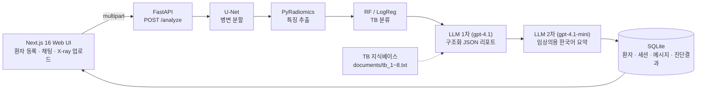

# X-ray TB Radiomics + LLM Diagnostic Assistant

흉부 X-ray에서 결핵(TB) 의심 병변을 U-Net으로 분할하고, 병변 영역의 Radiomics 특징과 ML 분류 결과를 LLM이 해석해 임상의용 리포트를 만들어 주는 임상 의사결정 지원(CDS) 프로토타입입니다.


<p align="center">
  
  
</p>
<p align="center"><sub>Shenzhen CXR 데이터셋에 대한 U-Net 병변 분할 결과 (붉은 영역 = 예측 마스크)</sub></p>

> **면책**: 연구·교육 목적의 프로토타입입니다. 의료기기가 아니며, 어떤 출력도 임상 판단을 대체하지 않습니다.

## 핵심 아이디어

딥러닝 분류기 하나로 "결핵 / 정상"을 찍는 대신, **찾기 → 수치화 → 판정 → 해석** 네 단계를 분리한 하이브리드 구조입니다. 각 단계의 출력이 사람이 읽을 수 있는 형태(마스크, 특징 수치, feature importance, 근거 필드)로 남아 설명 가능성을 확보합니다.

| 단계 | 기술 | 출력 |
| --- | --- | --- |
| 1. 병변 분할 | U-Net (TensorFlow/Keras) | 512×512 이진 마스크 |
| 2. 특징 추출 | PyRadiomics | 102개 정량 특징 (shape2D, first-order, GLCM, GLRLM, GLSZM, GLDM, NGTDM) |
| 3. 분류 | Logistic Regression / Random Forest (scikit-learn) | TB 확률, risk score, feature importance |
| 4. 해석 | OpenAI LLM 2단계 | ① 구조화 JSON 리포트 → ② 임상의용 한국어 요약 |

## 시스템 구성



> 현재 저장소에서 분할·특징 추출·분류(1~3단계)는 `model/` 의 **오프라인 파이프라인**으로 실행되고, 웹 백엔드의 `/analyze` 는 고정된 ML 결과 샘플을 LLM에 넘기는 데모 상태입니다. 실시간 추론 연결은 [로드맵](#현재-한계와-로드맵)의 첫 번째 항목입니다.

## 저장소 구조

```
.
├── model/                        # 오프라인 ML 파이프라인 (TensorFlow · PyRadiomics · scikit-learn)
│   ├── config.py                 # 이미지 크기, 학습률, 경로 등 하이퍼파라미터
│   ├── src/
│   │   ├── model.py · losses.py · dataset.py · train.py   # U-Net 정의 · 손실 · 데이터 · 학습
│   │   ├── infer.py · batch_infer.py · evaluate.py       # 단일/배치 추론 · 평가
│   │   ├── radiomics_extract.py                          # PyRadiomics 특징 추출
│   │   └── radiomics_classify.py · radiomics_report.py   # 분류 · JSON 리포트
│   ├── outputs/radiomics/        # 추출된 특징 CSV, classify_report.json
│   ├── MODEL_ARCH.md · WORKLOG.md · README.md            # 모델 상세 문서
│   └── 논문.pdf
├── WebBack/                      # FastAPI 백엔드
│   ├── main.py                   # API 라우트 + 2차 LLM 요약
│   ├── radiomics_llm_report2.py  # 1차 LLM 구조화 리포트
│   ├── DBTable.py · database.py  # SQLAlchemy 모델, SQLite
│   └── documents/                # TB 지식베이스 (tb_1 ~ tb_8.txt)
├── WebFront/                     # Next.js 16 · TypeScript · Tailwind 프론트엔드
│   ├── app/                      # 메인 채팅(/), 환자별 채팅(/patient/[id])
│   ├── components/               # ChatWindow · InputBar · PatientModal · Sidebar
│   └── utils/api.ts              # 백엔드 API 클라이언트
├── docs/samples/                 # 분할 결과 오버레이 예시
├── documents/ · tb_faiss_index/  # 초기 실험 산출물 (KB 사본, FAISS 인덱스)
├── radiomics_llm_report.py       # 1차 LLM 리포트 초기 버전 (단독 실행용)
└── Split_json.py
```

## 빠른 시작

사전 준비: Python 3.10+, Node.js 20+, OpenAI API 키.

### 1. 백엔드

```bash
cd WebBack
python -m venv .venv && source .venv/bin/activate
pip install -r requirements.txt
export OPENAI_API_KEY=sk-...
uvicorn main:app --reload --port 8000
```

`http://127.0.0.1:8000/docs` 에서 Swagger UI를 확인할 수 있습니다. 첫 실행 시 `xray_app.db`(SQLite)와 기본 의사 계정이 자동 생성됩니다.

### 2. 프론트엔드

```bash
cd WebFront
npm install
npm run dev
```

`http://localhost:3000` 에서 환자를 등록하고 X-ray를 업로드하면 LLM 분석 결과가 채팅으로 표시됩니다. 백엔드 주소는 `WebFront/utils/api.ts` 의 `BASE_URL`(기본 `http://127.0.0.1:8000`)로 지정합니다.

### 3. 모델 파이프라인 (오프라인)

```bash
cd model
pip install "tensorflow==2.15.*" "tensorflow-addons==0.22.*" pandas matplotlib pillow pyradiomics SimpleITK scikit-learn

# data/dataset.csv 에 image_path, mask_path 컬럼 준비 후
python src/train.py                                                     # U-Net 학습 → outputs/checkpoints/best_model.h5
python src/batch_infer.py --model_path outputs/checkpoints/best_model.h5 \
  --csv_path data/dataset.csv --output_dir outputs/predictions/batch --count -1 --overwrite
python src/radiomics_extract.py --csv_path data/dataset.csv --mask_source pred \
  --pred_mask_dir outputs/predictions/batch/masks --output_csv outputs/radiomics/features.csv
python src/radiomics_report.py --features_csv outputs/radiomics/features.csv \
  --output_json outputs/radiomics/classify_report.json
```

학습된 가중치(`best_model.h5`, `final_model.h5`, 각 89MB)와 대량 추론 결과는 저장소에 포함하지 않습니다. GitHub Releases에서 받아 `model/outputs/checkpoints/` 에 두거나 직접 학습하세요. 추론과 특징 추출은 CPU에서도 동작하며, 최신 GPU에서 CUDA 문제가 있으면 `CUDA_VISIBLE_DEVICES=""` 로 실행합니다.

## API

| Method | Path | 설명 |
| --- | --- | --- |
| `POST` | `/patients/register` | 환자 등록. 이름+생년월일이 같으면 기존 환자 반환 |
| `GET` | `/patients` | 환자 목록 (최근 등록순) |
| `GET` | `/patients/{id}` | 환자 상세 |
| `GET` | `/patients/{id}/messages` | 환자의 전체 대화 이력 |
| `POST` | `/analyze` | `patient_id`, `text`, `file`(이미지) multipart → 분석 결과와 LLM 응답 저장 후 반환 |

## 데이터와 모델

**데이터셋**: Shenzhen Hospital Chest X-ray (NIH/NLM 공개 데이터, 662장). 이 중 TB 양성 영상에 대한 병변 마스크 약 330장을 사용했고, 마스크가 없는 영상은 학습된 U-Net으로 자동 분할해 Radiomics 입력으로 활용합니다.

**U-Net 분할**
- 입력 512×512 grayscale, 직접 쌓은 encoder–decoder + skip connection, sigmoid 출력
- 손실 BCE + Dice, Adam(lr 1e-4), batch 4, 최대 100 epoch
- EarlyStopping(patience 10) · ReduceLROnPlateau(factor 0.5) · `val_dice_coefficient` 기준 best checkpoint
- 증강: 좌우 반전, 회전, 밝기·대비 변화 / train·val·test = 80·10·10 (seed 42)

**Radiomics**: PyRadiomics로 7개 특징군 102개 추출. RGB PNG를 단일 채널로 변환하고 임시 NRRD를 거쳐 추출하며, 마스크는 0.5 임계값으로 이진화합니다.

**분류기**: 430 샘플(TB 330 + synthetic normal 100), 102 특징으로 LogReg / Random Forest 학습. Random Forest 기준 상위 특징은 `glcm_Imc1`, `firstorder_Maximum`, `firstorder_Range` 이고 특징군별 기여는 GLCM 57%, first-order 24% 입니다.

> **성능 수치에 대한 주의**: 내부 검증 ROC-AUC는 1.0 으로 기록되어 있으나, 정상군 100개가 synthetic 샘플이라 과도하게 낙관적인 수치입니다. 실제 정상 CXR로 외부 검증을 거치기 전까지 성능 주장으로 해석하지 않습니다. (`model/outputs/radiomics/classify_report.json`)

## LLM 레이어

| 단계 | 모델 · 설정 | 입력 | 출력 |
| --- | --- | --- | --- |
| 1차 `WebBack/radiomics_llm_report2.py` | gpt-4.1, temperature 0.1, JSON mode | 모델 메타 + TB 지식베이스 + 케이스 JSON(Radiomics · ML 결과) | `clinical_overview`, `tb_risk_summary`, `lesions[]`, `ml_summary`, `recommendations_for_clinician`, `supporting_evidence[]`, `limitations` |
| 2차 `WebBack/main.py` | gpt-4.1-mini, temperature 0.2 | 1차 JSON 리포트 | 임상의용 한국어 요약 (해석 · 위험도 · 권고) |

프롬프트 제약: 확정 진단 금지, 모델 성능·synthetic 데이터 언급 금지, 환자용 어투 금지, 최종 판단은 의사에게 있음을 명시. 1차 출력은 JSON 파싱 실패 시 복구를 시도하고 `supporting_evidence` 형식을 정규화합니다.

TB 지식베이스(`WebBack/documents/`)는 질병 개요 · 증상 · 치료 원칙 · 영상 소견 · 패턴 기반 추론 · 감별 진단 · 분할 평가 지표 8개 문서로 구성되며, 현재는 전체를 프롬프트에 직접 주입합니다.

## 현재 한계와 로드맵

- [ ] `/analyze` 에 실시간 추론 연결: U-Net → PyRadiomics → 저장된 분류기(joblib) → LLM
- [ ] 실제 정상 CXR로 분류기 재학습·재검증 (synthetic normal 제거, 환자 단위 split, 교차검증)
- [ ] 설정 외부화 (API URL, DB URL, 모델 경로) · Docker Compose · CI
- [ ] 인증/권한, PostgreSQL, 업로드 파일 검증, CORS 제한
- [ ] 지식베이스 RAG 전환 (FAISS 인덱스 활용), structured outputs, 리포트 평가셋
- [ ] UI: 마스크 오버레이와 특징 표 표시, 의사 피드백(`doctor_feedback`) 수집 API

## 크레딧

Team Bodytalk 팀 프로젝트(2025.12)를 기반으로 재구성한 개인 포트폴리오 버전입니다.
