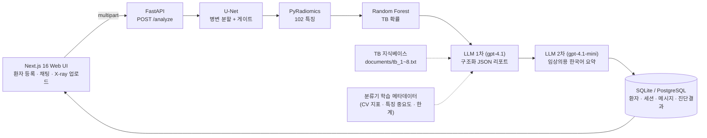

# X-ray TB Radiomics + LLM Diagnostic Assistant

흉부 X-ray에서 결핵(TB) 의심 병변을 U-Net으로 분할하고, 병변 영역의 Radiomics 특징을 분류기로 점수화한 뒤, 그 결과를 LLM이 임상의용 리포트로 해석해 주는 임상 의사결정 지원(CDS) 프로토타입입니다.


<p align="center">
  
  
</p>
<p align="center"><sub>Shenzhen CXR 데이터셋에 대한 U-Net 병변 분할 결과 (붉은 영역 = 예측 마스크)</sub></p>

> **면책**: 연구·교육 목적의 프로토타입입니다. 의료기기가 아니며, 어떤 출력도 임상 판단을 대체하지 않습니다.

## 한눈에 보기

| | |
| --- | --- |
| **입력** | 정면 흉부 X-ray (PNG/JPEG) + 임상의의 메모 |
| **출력** | 병변 오버레이, 폐야 구역·면적 통계, TB 확률과 위험도, 구조화 JSON 리포트, 한국어 임상의용 요약 |
| **실데이터 성능** | Shenzhen 662장 종단 ROC-AUC **0.897**, 민감도 81.9%, 특이도 85.6% ([상세](docs/evaluation.md)) |
| **지연** | 업로드 → 분할 → Radiomics → 분류까지 **0.3–0.5초** (CPU), 이후 LLM 2회 호출 |
| **스택** | TensorFlow 2.15 U-Net · PyRadiomics · scikit-learn · FastAPI · SQLAlchemy · Next.js 16 · OpenAI |

## 왜 이렇게 만들었나

딥러닝 분류기 하나로 "결핵 / 정상"을 찍지 않고 **찾기 → 수치화 → 판정 → 해석** 네 단계를 분리했습니다. 각 단계의 출력이 사람이 검토할 수 있는 형태(마스크, 특징 수치, feature importance, 근거 필드)로 남아서, 임상의가 "왜 이런 판단이 나왔는지"를 따라갈 수 있습니다.

| 단계 | 기술 | 출력 |
| --- | --- | --- |
| 1. 병변 분할 | U-Net (TensorFlow/Keras, 7.8M 파라미터) | 512×512 마스크, 확률맵 |
| 2. 게이트 + 통계 | 연결 성분 분석 | 면적 비율, 성분 수, 폐야 구역(right/left × upper/middle/lower) |
| 3. 특징 추출 | PyRadiomics | 102개 정량 특징 (shape2D, first-order, GLCM, GLRLM, GLSZM, GLDM, NGTDM) |
| 4. 분류 | Random Forest (scikit-learn, 5-fold CV ROC-AUC 0.891) | `tb_probability`, `risk_level`, 상위 기여 특징 |
| 5. 해석 | OpenAI LLM 2단계 | ① 구조화 JSON 리포트 (gpt-4.1, JSON mode) → ② 한국어 임상의용 요약 (gpt-4.1-mini) |

## 시스템 구성



학습·평가 스크립트와 API 서버가 **같은 파이프라인 코드**(`model/src/pipeline.py`)로 전처리·특징 추출을 하기 때문에, 학습 분포와 운영 분포가 어긋나지 않습니다. 전처리는 학습 때 쓴 `tf.image.resize`를 NumPy로 재현한 것으로, 마스크 IoU 0.99 로 검증했습니다.

## 저장소 구조

```
.
├── model/                        # cxr_tb 패키지: 파이프라인 · 학습 · 평가 (pip install -e model[inference])
│   ├── src/pipeline.py           # ★ 전처리 → U-Net → 게이트 → Radiomics → 분류기 (서빙/학습 공용)
│   ├── src/train.py · evaluate.py                  # U-Net 학습 · Dice/IoU
│   ├── src/build_manifest.py · extract_dataset_features.py
│   ├── src/evaluate_screening.py · train_classifier.py
│   ├── outputs/classifier/       # tb_classifier.joblib + classifier_report.json (커밋됨)
│   ├── outputs/evaluation/       # pipeline_features.csv, screening_metrics.json (커밋됨)
│   └── README.md · MODEL_ARCH.md · WORKLOG.md
├── WebBack/                      # FastAPI 백엔드
│   ├── main.py                   # 라우트, /analyze 흐름, lifespan 에서 모델 1회 로드
│   ├── inference.py              # 파이프라인 서빙 래퍼 (+ INFERENCE_BACKEND=fake)
│   ├── llm_report.py             # LLM 1차 리포트 · 2차 요약 · 후속 질문 (+ LLM_BACKEND=fake)
│   ├── settings.py · .env.example
│   ├── DBTable.py · database.py · schemas.py
│   ├── documents/                # TB 지식베이스 (tb_1 ~ tb_8.txt)
│   └── tests/                    # pytest (fake 백엔드로 TensorFlow/OpenAI 없이 실행)
├── WebFront/                     # Next.js 16 · TypeScript · Tailwind
├── scripts/                      # download_shenzhen.sh · download_models.sh
└── docs/                         # evaluation.md · MODEL_CARD.md · samples/
```

## 빠른 시작

사전 준비: Python 3.11, Node.js 20+, OpenAI API 키. (키가 없으면 `LLM_BACKEND=fake` 로 UI 까지 동작합니다.)

### 1. 모델 가중치

U-Net 가중치(`best_model.h5`, 89MB)는 git 에 없습니다. GitHub Releases 에서 받습니다.

```bash
scripts/download_models.sh          # → model/outputs/checkpoints/best_model.h5
```

분류기 번들(`model/outputs/classifier/tb_classifier.joblib`)은 저장소에 포함되어 있습니다.

### 2. 백엔드

```bash
cd WebBack
python3.11 -m venv .venv && source .venv/bin/activate
pip install "numpy<2" versioneer                            # PyRadiomics 소스 빌드 의존성 (먼저 설치)
pip install --no-build-isolation -e "../model[inference]"   # cxr_tb: TensorFlow 2.15, PyRadiomics, SimpleITK
pip install -r requirements.txt                             # FastAPI 등
cp .env.example .env                # OPENAI_API_KEY 입력
uvicorn main:app --reload --port 8000
```

`http://127.0.0.1:8000/docs` 에서 Swagger UI, `/health` 에서 로드된 모델과 교차검증 지표를 확인할 수 있습니다.

### 3. 프론트엔드

```bash
cd WebFront
npm install && npm run dev          # http://localhost:3000
```

백엔드 주소는 `NEXT_PUBLIC_API_BASE_URL` (기본 `http://127.0.0.1:8000`).

### 4. 테스트

```bash
cd WebBack && pytest                # 17 tests, fake 백엔드 (TensorFlow/OpenAI 불필요)
cd WebFront && npm run lint && npx tsc --noEmit
```

## API

| Method | Path | 설명 |
| --- | --- | --- |
| `GET` | `/health` | 상태, 추론/LLM 백엔드, 분류기 메타데이터 |
| `POST` | `/patients/register` | 환자 등록 (이름+생년월일 중복 시 기존 반환) |
| `GET` | `/patients` · `/patients/{id}` | 환자 목록 · 상세 |
| `GET` | `/patients/{id}/messages` | 대화 이력 (어시스턴트 메시지에 `analysis` 포함) |
| `POST` | `/analyze` | `patient_id`, `text`, `file` multipart. 이미지가 있으면 전체 파이프라인 + LLM 리포트, 없으면 최근 리포트를 컨텍스트로 한 후속 답변 |

`/analyze` 응답 예 (요약):

```json
{
  "id": 12, "role": "assistant", "content": "우상부 폐야에 ... 최종 판단은 담당의에게 있습니다.",
  "analysis": {
    "overlay_url": "http://127.0.0.1:8000/static/results/<id>_overlay.png",
    "segmentation": {"detected": true, "mask_area_fraction": 0.045, "num_components": 2, "zones": ["right upper zone", "left upper zone"]},
    "ml_results": {"primary_label": "tb_suspected", "tb_probability": 0.93, "risk_level": "high", "classifier": "rf",
                   "top_features": [{"feature": "original_glszm_SizeZoneNonUniformity", "importance": 0.061, "value": 412.3}]},
    "report": {"clinical_overview": "...", "tb_risk_summary": {"level": "high", "rationale": "..."}, "supporting_evidence": [...]}
  }
}
```

## 모델과 평가

**데이터**: Shenzhen Hospital CXR (NIH/NLM 공개), 662장 (TB 336 · 정상 326). `scripts/download_shenzhen.sh` 로 내려받아 전 과정을 재현할 수 있습니다.

**U-Net**: 512×512 grayscale, encoder–decoder + skip connection, BCE + Dice, Adam 1e-4, EarlyStopping / ReduceLROnPlateau, 증강(반전·회전·밝기·대비). TB 영상 약 330장의 병변 마스크로 학습.

**분류기**: 게이트를 통과한 617개 영역 (TB 병변 333 · 정상 영상의 위양성 영역 284), 102 특징, 5-fold stratified CV.

| 평가 | ROC-AUC | 민감도 | 특이도 |
| --- | --- | --- | --- |
| 분할 게이트만 (면적 비율 점수) | 0.868 | 99.1% @0.1% | 12.9% @0.1% |
| Random Forest (영역 단위, OOF) | 0.891 ± 0.025 | 82.6% | 83.5% |
| **게이트 + 분류기 (이미지 단위)** | **0.897** | **81.9%** | **85.6%** |

> 팀 프로젝트 단계의 ROC-AUC 1.0 은 합성(synthetic) 정상군 100개로 얻은 수치였습니다. 이 버전은 합성 데이터를 제거하고 실제 정상 영상으로 평가했습니다. U-Net 은 같은 데이터셋의 TB 영상으로 학습되었으므로 TB 쪽 분할은 in-sample 이고 정상 영상은 out-of-sample 입니다. 상세와 한계는 [docs/evaluation.md](docs/evaluation.md), [docs/MODEL_CARD.md](docs/MODEL_CARD.md).

## LLM 레이어

| 단계 | 모델 · 설정 | 입력 | 출력 |
| --- | --- | --- | --- |
| 1차 리포트 | gpt-4.1, temperature 0.1, JSON mode | 케이스 JSON(분할 통계·102 특징·분류 결과) + TB 지식베이스 + 분류기 학습 메타데이터 | `clinical_overview`, `tb_risk_summary`, `lesion_summary`, `ml_summary`, `recommendations_for_clinician`, `supporting_evidence[]`, `limitations` |
| 2차 요약 | gpt-4.1-mini, temperature 0.2 | 1차 리포트 (+ 임상의 메모) | 한국어 임상의용 요약 |
| 후속 질문 | gpt-4.1-mini | 질문 + 세션의 최근 리포트 | 한국어 답변 |

프롬프트 제약: 케이스 JSON 에 없는 수치 금지, 구역(zone)을 엽(lobe)으로 승격 금지, 확정 진단·환자용 어투 금지, 최종 판단은 의사. `no_lesion_detected` 케이스는 병변 서술 대신 임상 상관을 권고합니다.

## 로드맵

- [x] `/analyze` 실시간 추론 (U-Net → Radiomics → 분류기 → LLM), 고정값 데모 제거
- [x] 합성 정상군 제거, 실제 정상 영상으로 교차검증 · 종단 지표 · 모델 카드
- [x] 설정 외부화(pydantic-settings), fake 백엔드, pytest
- [ ] Docker Compose · GitHub Actions CI · PostgreSQL · 인증 · 업로드/CORS 제한
- [ ] LLM: structured outputs · 재시도/폴백 · 토큰·지연 추적 · 지식베이스 RAG · 평가셋
- [ ] UI: 오버레이·특징 표·리포트 뷰어 · 스트리밍 · 의사 피드백 · 세션 관리
- [ ] 외부 데이터셋 검증 (Montgomery, TBX11K)

## 크레딧

Team Bodytalk 팀 프로젝트(2025.12)를 기반으로 재구성한 개인 포트폴리오 버전입니다. 데이터: Shenzhen Hospital X-ray Set (Jaeger S. et al., NLM).
